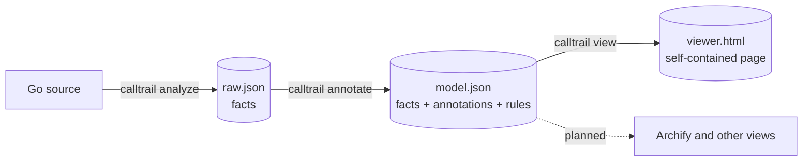

# calltrail

[English](README.en.md) | [中文](README.md)

**A call-graph explorer for Go.** It extracts call relations from Go source *mechanically*, with real type information (`go/packages` + SSA), keeps facts and presentation apart in three layers, and renders a self-contained HTML page.



## Why

Code can now be generated faster than anyone can read it. Reviewing every line by hand does not scale; handing the whole review to another model means losing control. calltrail extracts the structure of a program *mechanically* and shows it in a form a person can take in quickly, so they can understand the core of a system and judge what a change affects.

- **Structure comes from a program, not from a model.** Nodes and edges come only from compiler-grade analysis.
- **Every edge points at code** (`file:line`).
- **Uncertainty is marked, not hidden.** Interface dispatch, reflection and the like are blind spots of static analysis; they are visible in the graph and have been checked against runtime call stacks. The numbers are in [docs](docs/validation.en.md).
- **Facts and decisions are separate.** The raw layer holds facts only; "what is noise, what to hide first" is the second layer; how to draw is the third.
- **Deterministic.** The same code and the same flags give identical output.

## Quick start

You need Go (the tool runs `go list`; building this project needs Go 1.26 or newer, because the x/tools version it depends on requires it).

```bash
git clone https://github.com/hangyu629/calltrail.git
cd calltrail
go build -o calltrail ./cmd/calltrail

# analyse another Go module (-C points at the directory that has go.mod)
./calltrail run -C ~/code/my-service -out-dir ./my-service-out ./...
open ./my-service-out/viewer.html      # macOS; elsewhere just open the file in a browser
```

You can also use `go run ./cmd/calltrail run ...`, or analyse this repository itself: `./calltrail run -out-dir calltrail-out ./...`.

Three files come out:

| File | What it is |
|---|---|
| `raw.json` | Raw layer: packages, functions, external dependencies, edges (with call sites), roles |
| `model.json` | Model layer: the raw layer plus annotations (module, internal?, fan-in, reachability, hidden by default and why) |
| `viewer.html` | View layer: one file, no server needed, open it directly |

## Usage

### What to analyse

```bash
./calltrail run -C ~/code/my-service ./...                               # the whole module
./calltrail run -C ~/code/my-service ./cmd/... ./internal/order/...      # a part of it
./calltrail run -C ~/code/my-service -tags integration,linux ./...       # build tags
```

- **`-C`**: root of the Go module; defaults to the current directory.
- **`-out-dir`**: output directory (default `calltrail-out`), relative to **where you run the command**, not to `-C`.
- **Requirement**: the target must build with `go build` (dependencies downloaded). Results are valid only for that GOOS / GOARCH / tags.
- **Large projects**: narrow the scope with `./cmd/...`. x/tools `./cmd/...` (about 2700 own functions) takes roughly 2 s and 1.2 GB of memory.

### Starting from an entry

To see the call tree *from one entry point*, use `-entry` (paths are relative to `-C`). It replaces the package patterns:

```bash
./calltrail run -C ~/code/my-service -entry cmd/server/main.go -out-dir ./out    # a file
./calltrail run -C ~/code/my-service -entry ./cmd/server -out-dir ./out          # a package
./calltrail run -C ~/code/my-service -entry cmd/server:Run -out-dir ./out        # a function of a package
./calltrail run -C ~/code/my-service -entry internal/order/service.go:Service.Create -out-dir ./out
```

- **File**: Go compiles packages, not files, so a file cannot be analysed on its own. calltrail analyses the **package the file belongs to**, then picks the entry functions inside it: `main` if the file declares it, otherwise every function the file declares.
- **Package**: `main` if it is a main package, otherwise its exported functions.
- **`:FuncName`**: an exact function; write methods as `Type.Method`.
- The resolved entry functions are printed. Use either `-entry` or package patterns, not both.
- Effect: only the entry's package and its dependencies are loaded; every node in `model.json` carries `reachable`; the page opens on the entry, "all downstream" is the full call tree, and by default only what the entry can reach is shown.

### Choosing the algorithm

```bash
./calltrail run -C ~/code/my-service -algo vta ./...    # default, most precise
./calltrail run -C ~/code/my-lib -algo cha ./...        # more complete, more redundant
```

The default `vta` suits programs that have a `main`. A **library** gets its concrete types from outside, which VTA cannot see, so at call sites where VTA resolves nothing at all calltrail falls back to class-hierarchy analysis and marks those edges low-confidence (hidden by default).

### Step by step

```bash
./calltrail analyze  -C ~/code/my-service -o raw.json ./...               # layer 1
./calltrail annotate -rules calltrail.rules.json -o model.json raw.json   # layer 2
./calltrail view     -o viewer.html model.json                            # layer 3
```

Analysis is the slow part. To change only the rules or the view, reuse the same `raw.json` and rerun the last two steps.

## Using the page

- **Overview / focus**: for large projects the page opens in focus mode. Pick an entry (or search for a function) to see only its upstream and downstream; double-click any node to make it the new centre.
- **Click a node**: highlights its upstream and downstream and shows details and call sites in the side panel. Click an edge to see all of its call sites.
- **"Hide common dependencies" in the top bar**: hides standard-library packages that are called from everywhere, such as `fmt` and `errors` (on by default).
- **"Filter" panel**: show what is hidden by reason; hide "common" dependencies or functions by **how many functions call them**; manage ignore rules; with an entry, show only what the entry can reach.
- **Dark / light**: the button at the top right; follows the system by default.

### Ignore rules

```json
{"rules": [
  {"module": "golang.org/x/sys"},
  {"package": "internal/gen/*"},
  {"function": "internal/util.*"},
  {"tag": "internal"}
]}
```

Load them with `-rules calltrail.rules.json`. Rules you set in the page can be exported ("Export rules") in the same format. Matching is by path prefix at element boundaries, and the fields of one rule must all match; see [docs/architecture-layers.en.md](docs/architecture-layers.en.md).

### Viewing a very large result

Small projects: just open `viewer.html`. When the result is large (several MB), some environments refuse to load it from `file://`; serve it locally instead:

```bash
python3 -m http.server 8000 --directory ./my-service-out    # then open http://127.0.0.1:8000/viewer.html
```

## Architecture

Three layers; only JSON files connect them:

| Layer | File | Code | Does only this |
|---|---|---|---|
| 1 Raw | `raw.json` | [internal/analyze](internal/analyze), [internal/graph](internal/graph) | Records what **is** in the code; decides nothing |
| 2 Model | `model.json` | [internal/model](internal/model) | Adds annotations and rules; never changes a fact |
| 3 View | `viewer.html` | [internal/render](internal/render) | Turns the model into a page to browse |

The full set of architecture diagrams (analysis pipeline, data model, front end, verification tools, ...) is in **[docs/architecture.en.md](docs/architecture.en.md)**.

## Documentation

| Document | Content |
|---|---|
| [docs/architecture.en.md](docs/architecture.en.md) | Architecture diagrams and a description of each layer |
| [docs/architecture-layers.en.md](docs/architecture-layers.en.md) | Fields of the three layers, rule format, three ways to deal with "too many common things", entries and reachability |
| [docs/validation.en.md](docs/validation.en.md) | Summary of how the analysis was verified, with the numbers |
| [docs/precision-audit-2026-11-05.md](docs/precision-audit-2026-11-05.md), [docs/recall-check-2026-11-05.md](docs/recall-check-2026-11-05.md), [docs/generics-validation-2026-11-05.md](docs/generics-validation-2026-11-05.md) | The detailed validation records (Chinese only) |

## Verification

The analysis is checked in two ways that do not depend on the call-graph algorithm; the tools are in [tools/recall](tools/recall): instrument a target, run it for real, record call stacks and compare them with the graph (recall); and read every statically resolvable call from the syntax tree and check it against the graph in both directions. Results on golang.org/x/tools (`./cmd/...`) and on the official MCP SDK (generics-heavy) are summarised in [docs/validation.en.md](docs/validation.en.md).

```bash
go test ./...        # tests for the analyzer and the model layer (generics, entries, rules, ...)
```

## Known limitations

- Interface dispatch and calls through function values are approximations in any static analysis: there are extra edges (marked and folded by default) and some missing ones; see the validation documents.
- "Probably unused" is not proof of dead code: reflection by name and cgo exports are not modelled.
- The page itself is in Chinese only; there is no language switch yet.
- Not done yet: exports to other views such as Archify, and gRPC / HTTP entry detection.

## Layout

| Path | Content |
|---|---|
| `cmd/calltrail` | Command line |
| `internal/analyze` | Layer 1: the analyzer |
| `internal/graph` | Schema of `raw.json` |
| `internal/model` | Layer 2: annotations, rules, filtering |
| `internal/render` | Layer 3: the built-in front end (bundles [elkjs](https://github.com/kieler/elkjs) for layout) |
| `tools/recall` | Verification tools |
| `docs/` | Design and validation records |

## License

The code of this repository has no license yet. The bundled [elkjs](https://github.com/kieler/elkjs) is dual-licensed EPL-2.0 or GPL-3.0-or-later; see [internal/render/ELK-LICENSE.md](internal/render/ELK-LICENSE.md). The analyzer depends on [golang.org/x/tools](https://pkg.go.dev/golang.org/x/tools) (BSD).
