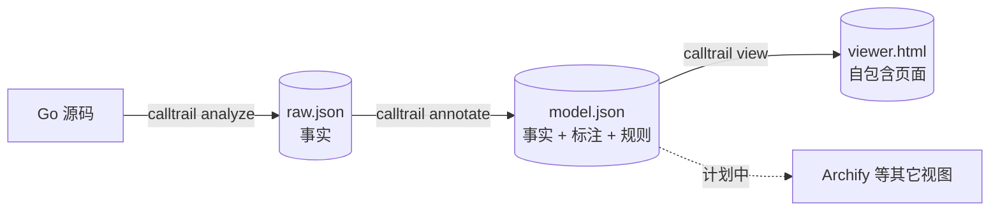

# calltrail

[English](README.en.md) | [中文](README.md)

**Go 调用图工具**：用 `go/packages` + SSA（带类型信息的静态分析）从 Go 源码**机械地**提取调用关系，整理成三层产出，再用一个自包含的网页浏览。

*A call-graph explorer for Go. It extracts call relations with real type information (x/tools), keeps facts and presentation apart in three layers, and renders a self-contained HTML page. Written for the moment when code is generated faster than anyone can read it.*



## 为什么做它

AI 能在很短的时间里生成大量代码，人逐行 review 不现实，全交给 AI review 又会让人失去掌控。calltrail 做的是：从代码里**机械地**提取结构，用人能快速把握的方式呈现，让人理解系统的核心、判断一次变更的影响。

- **结构由程序提取，不由模型推断**：节点和边只来自编译器级的分析。
- **每条边都能追溯到代码位置**（文件:行号）。
- **不确定就标出来**：接口分发、反射等静态分析的盲区在图上可见，并用运行时调用栈核对过，数据见 [docs](docs/)。
- **事实与取舍分开**：原始层只放事实；“哪些是噪音、哪些先藏起来”是第二层；怎么画是第三层。
- **确定性**：同一份代码、同一组参数，输出完全一致。

## 快速开始

需要 Go（工具会调用 `go list`；构建本项目需要 Go 1.26 以上）。

```bash
git clone https://github.com/hangyu629/calltrail.git
cd calltrail
go build -o calltrail ./cmd/calltrail

# 分析另一个 Go module（-C 指向有 go.mod 的目录）
./calltrail run -C ~/code/my-service -out-dir ./my-service-out ./...
open ./my-service-out/viewer.html      # macOS；其它系统直接用浏览器打开
```

也可以直接 `go run ./cmd/calltrail run ...`，或分析本仓库自己：`./calltrail run -out-dir calltrail-out ./...`。

得到三个文件：

| 文件 | 是什么 |
|---|---|
| `raw.json` | 原始层：包、函数、外部依赖、边（含调用点位置）、role |
| `model.json` | 加工层：在原始层上加标注（模块、是否 internal、调用次数、可达性、默认隐藏及原因） |
| `viewer.html` | 视图层：单个文件，不需要服务器，直接打开 |

## 用法

### 分析哪些代码

```bash
./calltrail run -C ~/code/my-service ./...                  # 整个 module
./calltrail run -C ~/code/my-service ./cmd/... ./internal/order/...   # 一部分
./calltrail run -C ~/code/my-service -tags integration,linux ./...    # 构建标签
```

- **`-C`**：Go module 的根目录；不写就是当前目录。
- **`-out-dir`**：输出目录（默认 `calltrail-out`），相对**你运行命令的位置**，不是相对 `-C`。
- **要求**：目标能 `go build` 通（依赖已下载）。结果只对这一组 GOOS / GOARCH / tags 有效。
- **项目很大**：用 `./cmd/...` 缩小范围。x/tools 的 `./cmd/...`（约 2700 个自有函数）约 2 秒、1.2 GB 内存。

### 指定入口

想看“从某个入口出发”的调用树，用 `-entry`（路径相对 `-C`），它代替包路径：

```bash
./calltrail run -C ~/code/my-service -entry cmd/server/main.go -out-dir ./out    # 一个文件
./calltrail run -C ~/code/my-service -entry ./cmd/server -out-dir ./out          # 一个包
./calltrail run -C ~/code/my-service -entry cmd/server:Run -out-dir ./out        # 包里的一个函数
./calltrail run -C ~/code/my-service -entry internal/order/service.go:Service.Create -out-dir ./out
```

- **文件**：Go 以包为单位编译，所以文件不能单独分析。工具分析这个文件**所在的包**，再从中选入口函数：文件里声明了 `main` 就取 `main`，否则取这个文件里声明的所有函数。
- **包**：是 main 包就取 `main`，否则取它导出的函数。
- **`:函数名`**：精确指定，方法写成 `Type.Method`。
- 解析出的入口函数会打印出来；`-entry` 和包路径二选一。
- 效果：只加载入口所在的包和它的依赖；`model.json` 里每个节点带 `reachable`；网页直接打开在入口上，下游选“全部”就是完整调用树，并默认只显示入口可达的部分。

### 选算法

```bash
./calltrail run -C ~/code/my-service -algo vta ./...    # 默认，最准
./calltrail run -C ~/code/my-lib -algo cha ./...        # 更全但更冗余
```

默认 `vta` 适合有 `main` 的服务。对**库**，具体类型由外部使用者传进来，VTA 看不到，所以工具会在 VTA 完全解不出来的调用点自动回退到类层次分析，并标记为“低可信”（默认隐藏）。

### 分步执行

```bash
./calltrail analyze  -C ~/code/my-service -o raw.json ./...          # 第 1 层
./calltrail annotate -rules calltrail.rules.json -o model.json raw.json   # 第 2 层
./calltrail view     -o viewer.html model.json                       # 第 3 层
```

分析最慢。想只换规则或视图，复用同一个 `raw.json` 再跑后两步即可。

## 在网页里怎么用

- **总览 / 聚焦**：项目大时默认进聚焦模式——选一个入口（或搜索函数名），只画它的上下游；双击任意节点设为新的中心。
- **点节点**：高亮上下游，侧栏显示详情和调用点位置；点连线看这条边的所有调用点。
- **顶栏「隐藏常见依赖」**：隐藏 `fmt`、`errors` 这类到处都在调用的标准库依赖（默认开）。
- **「过滤」面板**：按原因显示被隐藏的内容；按**调用次数**隐藏“常见”的依赖或函数；管理忽略规则；有入口时可以只看入口可达的部分。
- **深色 / 浅色**：右上角按钮，默认跟随系统。
- **中文 / English**：右上角的语言按钮。默认按浏览器语言（中文系统显示中文，其它显示英文），选择记在浏览器里。

### 忽略规则

```json
{"rules": [
  {"module": "golang.org/x/sys"},
  {"package": "internal/gen/*"},
  {"function": "internal/util.*"},
  {"tag": "internal"}
]}
```

用 `-rules calltrail.rules.json` 带入。在网页里设置的规则可以「导出规则」得到同样格式的文件。匹配按路径元素边界的前缀，一条规则里的多个字段要同时满足，详见 [docs/architecture-layers.md](docs/architecture-layers.md)。

### 查看很大的结果

小项目直接打开 `viewer.html`。结果很大（几 MB）时，有的环境不允许 `file://` 页面加载，可以起一个本地服务：

```bash
python3 -m http.server 8000 --directory ./my-service-out    # 访问 http://127.0.0.1:8000/viewer.html
```

## 架构

三层产出，层与层之间只有 JSON 文件相连：

| 层 | 文件 | 代码 | 只做什么 |
|---|---|---|---|
| 1 原始层 | `raw.json` | [internal/analyze](internal/analyze)、[internal/graph](internal/graph) | 记录代码里**有什么**，不做取舍 |
| 2 加工层 | `model.json` | [internal/model](internal/model) | 只追加标注和规则，不改事实 |
| 3 视图层 | `viewer.html` | [internal/render](internal/render) | 把 model 变成一个浏览用的页面 |

完整的架构图（分析流水线、数据模型、前端、验证工具等）见 **[docs/architecture.md](docs/architecture.md)**。

## 文档

| 文档 | 内容 |
|---|---|
| [docs/architecture.md](docs/architecture.md)（[English](docs/architecture.en.md)） | 架构图与各层说明 |
| [docs/architecture-layers.md](docs/architecture-layers.md)（[English](docs/architecture-layers.en.md)） | 三层的字段、规则格式、常见依赖的三种处理办法、入口与可达性 |
| [docs/validation.en.md](docs/validation.en.md) | 验证方法与数字的英文摘要（详细记录见下面三份） |
| [docs/precision-audit-2026-11-05.md](docs/precision-audit-2026-11-05.md) | 精度抽查：多余的边有多少、集中在哪 |
| [docs/recall-check-2026-11-05.md](docs/recall-check-2026-11-05.md) | 漏边验证：用运行时调用栈核对静态图 |
| [docs/generics-validation-2026-11-05.md](docs/generics-validation-2026-11-05.md) | 在真实的泛型项目上的验证 |

## 验证

分析器的结论用两种与调用图算法无关的办法核对，工具在 [tools/recall](tools/recall)：给目标插桩、真实运行并记录调用栈，与图比对（召回）；以及从语法树里读出所有静态可确定的调用，与图双向核对。在 golang.org/x/tools（`./cmd/...`）和官方 MCP SDK（泛型较多）上的数据见上面的文档。

```bash
go test ./...        # 分析器、加工层的测试（含泛型、入口、规则等用例）
```

## 已知局限

- 接口分发、函数值调用是静态分析的近似：会有多余的边（已标记并默认折叠），也会漏掉一些情况；数据见 `docs/`。
- 「疑似未使用」不是死代码的证明：按名字的反射、cgo 导出没有建模。
- 还没做：Archify 等其它视图的导出、gRPC / HTTP 入口识别。

## 目录

| 路径 | 内容 |
|---|---|
| `cmd/calltrail` | 命令行 |
| `internal/analyze` | 第 1 层：分析器 |
| `internal/graph` | `raw.json` 的 schema |
| `internal/model` | 第 2 层：标注、规则、过滤 |
| `internal/render` | 第 3 层：自研前端（内嵌 [elkjs](https://github.com/kieler/elkjs) 做布局） |
| `tools/recall` | 验证工具 |
| `docs/` | 设计与验证记录 |

## 许可

本仓库自己的代码尚未选择许可证。内嵌的 [elkjs](https://github.com/kieler/elkjs) 采用 EPL-2.0 或 GPL-3.0-or-later 双许可，许可文本见 [internal/render/ELK-LICENSE.md](internal/render/ELK-LICENSE.md)。分析器依赖 [golang.org/x/tools](https://pkg.go.dev/golang.org/x/tools)（BSD）。
