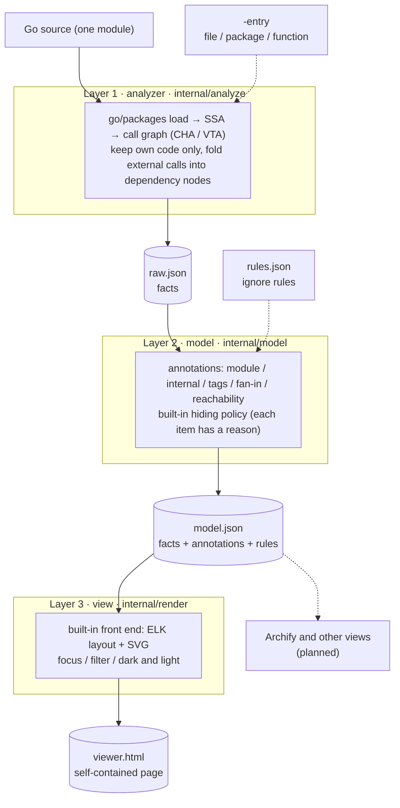
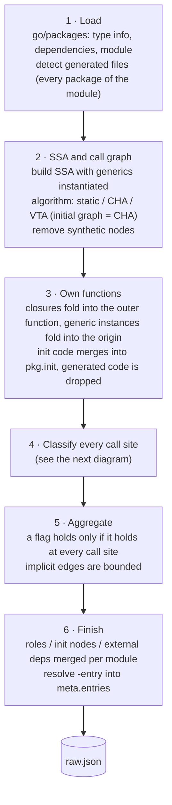
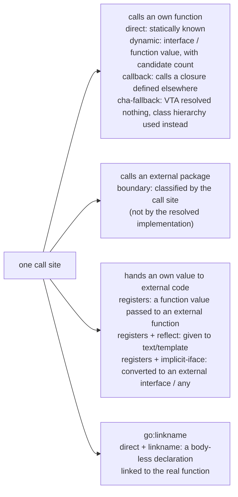
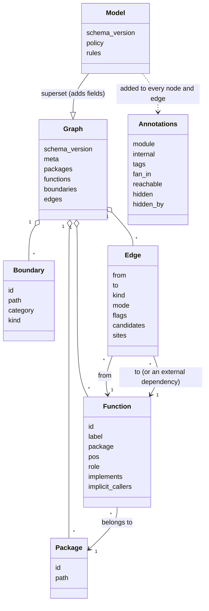
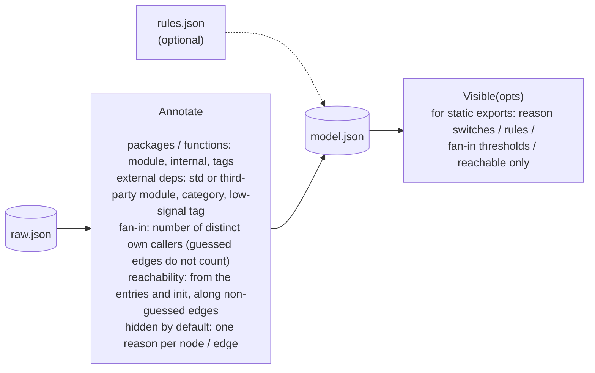
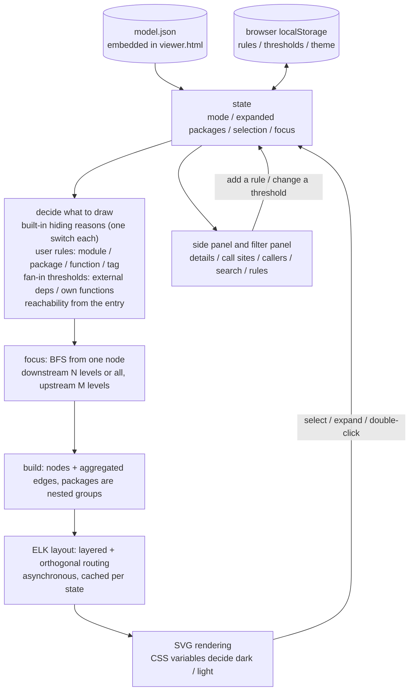
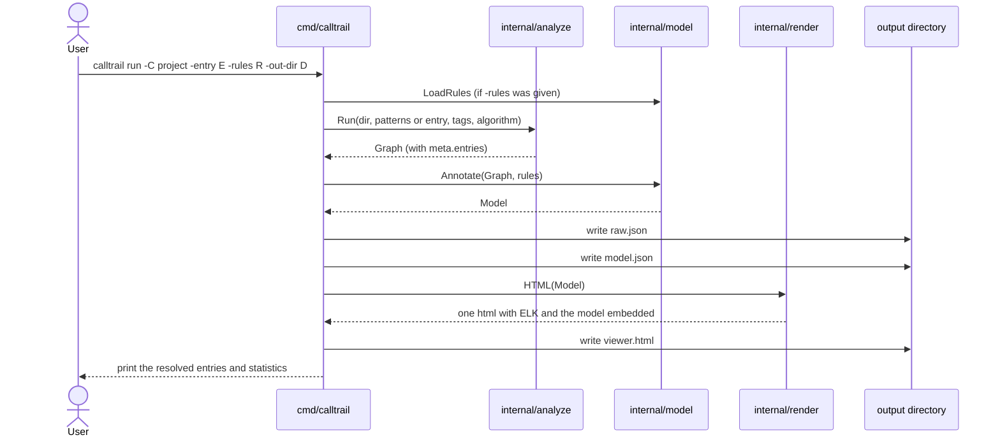
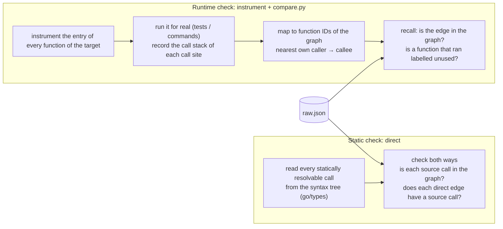
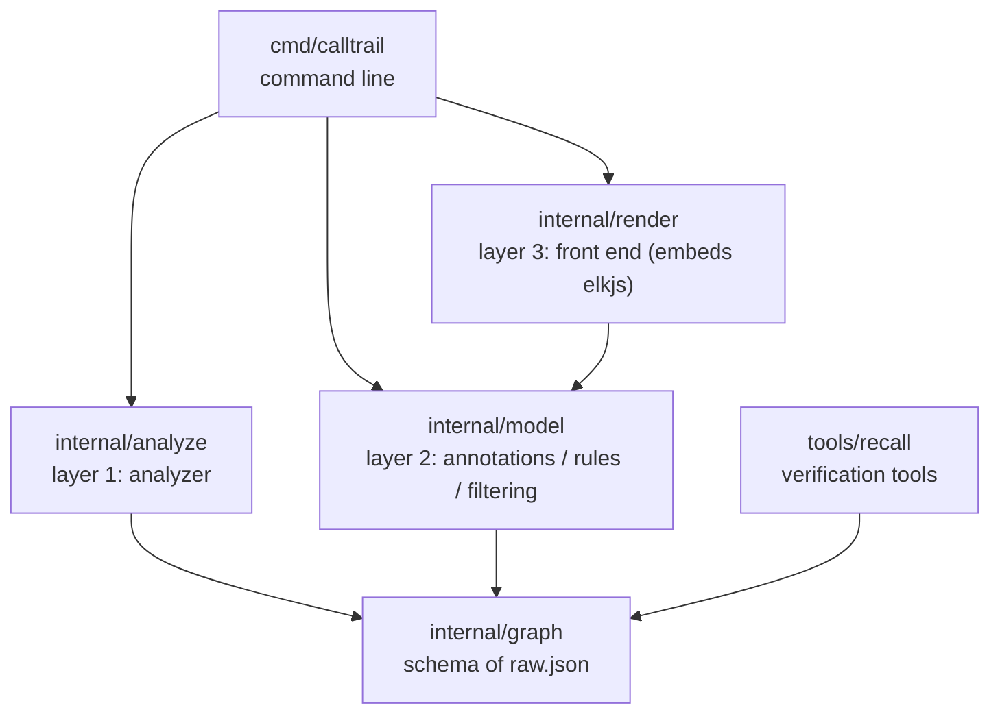

# Architecture

[English](architecture.en.md) | [中文](architecture.md)

calltrail extracts the call relations of Go code *mechanically*, organises them in three layers of output, and browses them in a self-contained web page. The diagrams below are [Mermaid](https://mermaid.js.org/); GitHub renders them directly.

Contents

1. [Design principles](#design-principles)
2. [Overview: three layers of output](#overview-three-layers-of-output)
3. [Layer 1: how the analyzer produces raw.json](#layer-1-how-the-analyzer-produces-rawjson)
4. [Data model: raw and model](#data-model-raw-and-model)
5. [Layer 2: what the model layer does](#layer-2-what-the-model-layer-does)
6. [Layer 3: how the front end draws](#layer-3-how-the-front-end-draws)
7. [What happens in one `calltrail run`](#what-happens-in-one-calltrail-run)
8. [Verification tools](#verification-tools)
9. [Package layout](#package-layout)

## Design principles

1. **Structure comes from a program, not from a model.** Nodes and edges come only from compiler-grade analysis (`go/packages` + SSA + a call-graph algorithm).
2. **Every assertion has evidence.** Every edge carries its call sites (`file:line`); uncertain edges carry a flag instead of being silently dropped or passed off as certain.
3. **Facts and decisions are separate layers.** The raw layer holds facts only; "what is noise, what to hide first, what the user wants to ignore" belongs to layer 2; how to draw belongs to layer 3.
4. **Deterministic.** The same code and flags give identical output (stable IDs, stable ordering, a fixed random seed for layout).
5. **Few and precise by default.** No full-graph dump: start from a package overview or focus from an entry; details on demand.
6. **Mark what is uncertain.** Interface dispatch, reflection, `go:linkname` and other blind spots of static analysis are visible in the graph and have been quantified with runtime checks.

## Overview: three layers of output

| Layer | File | Implementation | Does only this |
|---|---|---|---|
| 1 | `raw.json` | [internal/analyze](../internal/analyze), [internal/graph](../internal/graph) | Records what **is** in the code: packages, functions, external dependencies, edges (with call sites), roles. Drops no external dependency, holds no presentation policy |
| 2 | `model.json` | [internal/model](../internal/model) | **Only adds fields** to the raw layer: module, internal?, fan-in, reachability, hidden by default and why; carries the user's rules. Never changes or removes a fact |
| 3 | `viewer.html` | [internal/render](../internal/render) | Turns the model into a page to browse. Every view is a read-only transformation of the model |

Only JSON files connect the layers, so the analysis (the slow part) runs once; changing rules or views reruns only the later layers.

## Layer 1: how the analyzer produces raw.json

### What one call site becomes

The **flags** on an edge say how far to trust it:

| Flag | Meaning |
|---|---|
| `external-iface` | A dynamic call on an interface declared outside the module (such as `types.Type` or `error`); an own type merely happens to implement it. Wrong edges concentrated here in the precision audit |
| `table` | The callee is taken from a map / slice element; at run time only one of the candidates runs |
| `cha-fallback` | VTA resolved no candidate at all; every implementation from class-hierarchy analysis is used instead (common in libraries) |
| `implicit-iface` | After an own type is converted to an external interface, external code may call its methods (an over-approximation) |
| `reflect` | An own value handed to a template, which calls its exported methods by name |
| `linkname` | A body-less declaration linked by `//go:linkname` |

A function's **role** says why it has (or lacks) callers: `entry`, `init`, `registered`, `implicit`, `generated`, `iface`, `api`, `referenced`, `unused`; empty means some function calls it. See the comments in [graph.go](../internal/graph/graph.go).

## Data model: raw and model

- **Function IDs** are package-qualified names such as `(*internal/order.Service).Create`, without line numbers, so an ID survives code moving around and two results can be diffed.
- **External dependencies**: standard-library packages stay separate; third-party packages merge into one node per module.
- **Edge `kind`**: `direct`, `dynamic`, `registers`, `callback`, `boundary`. **`mode`**: `call`, `go`, `defer`.

## Layer 2: what the model layer does

### Two sources of hiding

| Source | Decided by | Represented as |
|---|---|---|
| **Built-in policy** | the model layer | Written to `hidden` / `hidden_by`, with three reasons: `low-confidence` (low-confidence edges), `implicit` (implicit edges), `low-signal` (common dependencies such as `fmt` and `errors`) |
| **Rules** | the user | **Not** written to `hidden`; they travel in `model.rules` and are applied by whoever draws. In the browser they can be switched on and off, added and removed without re-running the analysis |

Rules match a path prefix at element boundaries: `golang.org/x/tools` matches its sub-packages but not `golang.org/x/toolsfoo`; a trailing `*` means a plain prefix; the fields of one rule must all match. The matching is implemented once in Go (`Rule.Matches*`) and once in the front end, and both were checked against the same set of cases.

## Layer 3: how the front end draws

Notes:
- **The layout is cached**: it is recomputed only when the drawn graph changes (expand, focus, hiding conditions); selecting and searching never re-layout.
- **The layout is deterministic**: ELK runs with a fixed random seed, so the same input gives the same layout.
- **Dark / light**: every colour comes from a CSS variable and node colours are resolved at draw time, so switching theme redraws without re-layout.
- **Large-graph guard**: ELK blocks the page when there are many nodes, so the page says so before laying out and suggests focus mode.

## What happens in one `calltrail run`

## Verification tools

The analyzer's results are checked in two ways that are **independent of the call-graph algorithm**; the tools are in [tools/recall](../tools/recall):

- The **static check** finds: missed direct calls, extra direct edges, whether generic instances fold correctly.
- The **runtime check** finds the blind spots of static analysis: interface dispatch, callbacks, reflection, initialisation.
- A summary with the numbers: [validation.en.md](validation.en.md). The detailed records (Chinese): [precision-audit](precision-audit-2026-11-05.md) (sampling extra edges), [recall-check](recall-check-2026-11-05.md) (finding missed edges with runtime call stacks), [generics-validation](generics-validation-2026-11-05.md) (a real generics-heavy project).

## Package layout

| Path | Content |
|---|---|
| `internal/analyze` | `analyze.go` main flow; `implicit.go` implicit edges / init / linkname; `ifaces.go` interfaces and generics; `entry.go` entry resolution; `classify.go` helpers |
| `internal/graph` | The schema and stable ordering |
| `internal/model` | `model.go` annotations and filtering; `rules.go` the rules file |
| `internal/render` | `viewer.html` (the front end, one file); `render.go` embedding and filling in; `elk.bundled.js` ([elkjs](https://github.com/kieler/elkjs) layout engine, EPL-2.0, see [ELK-LICENSE.md](../internal/render/ELK-LICENSE.md)) |
| `tools/recall` | `instrument` instrumentation; `compare.py` runtime check; `direct` static check |
