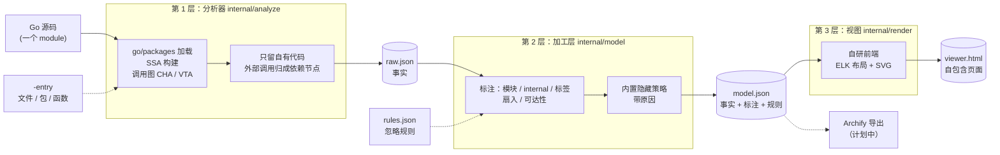
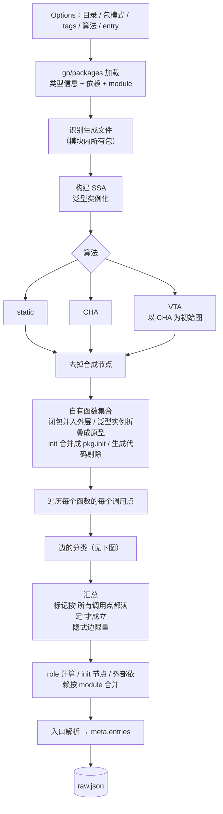
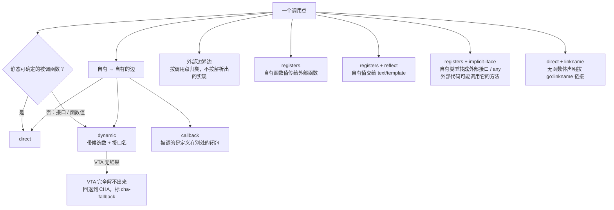
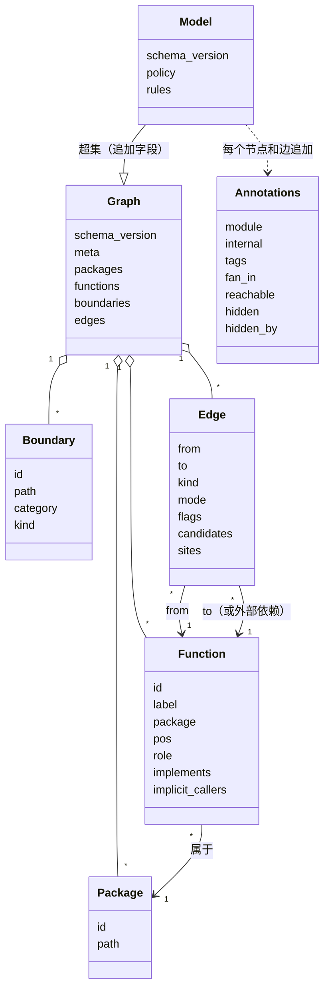
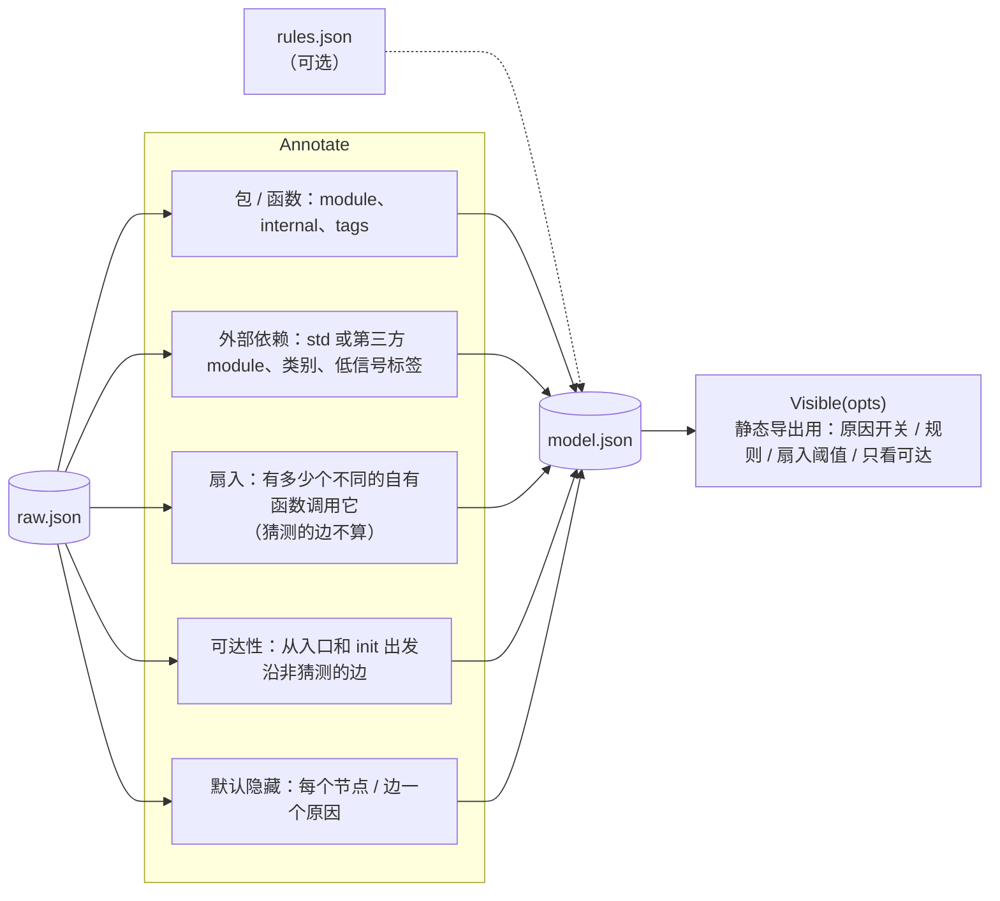
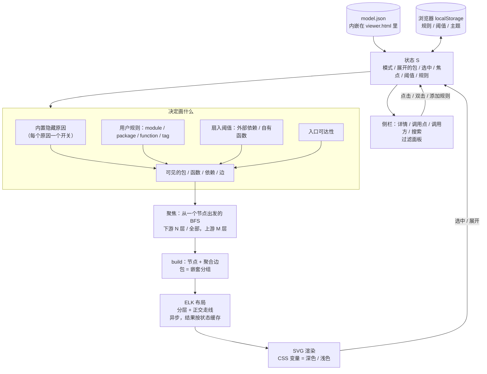
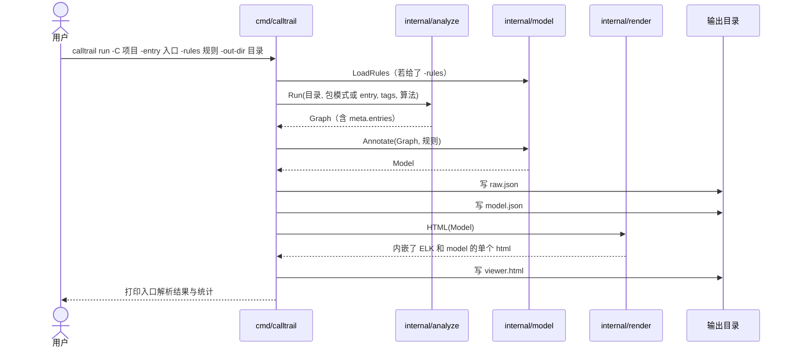
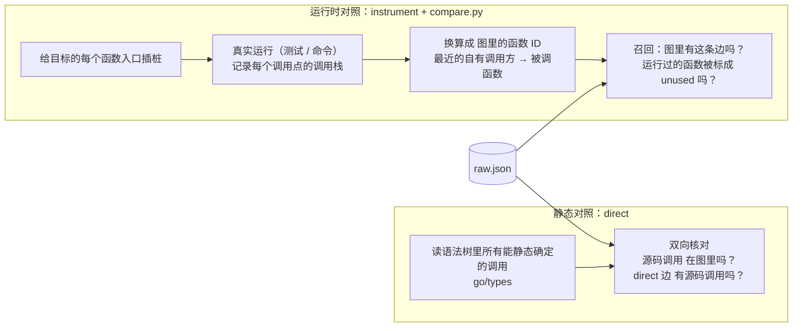
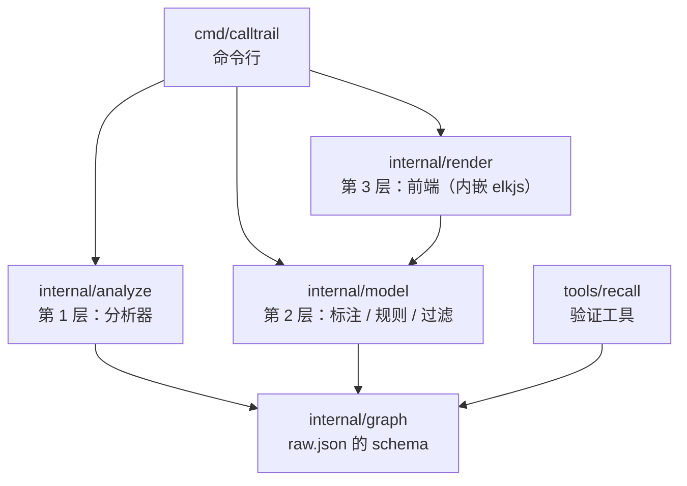

# 架构

calltrail 把 Go 代码里的调用关系**机械地**提取出来，整理成三层产出，再用一个自包含的网页浏览。下面的图都是 [Mermaid](https://mermaid.js.org/)，GitHub 上直接渲染。

目录

1. [设计原则](#设计原则)
2. [整体：三层产出](#整体三层产出)
3. [第 1 层：分析器怎么得到 raw.json](#第-1-层分析器怎么得到-rawjson)
4. [数据模型：raw 与 model](#数据模型raw-与-model)
5. [第 2 层：加工层做什么](#第-2-层加工层做什么)
6. [第 3 层：前端怎么画](#第-3-层前端怎么画)
7. [一次 `calltrail run` 发生了什么](#一次-calltrail-run-发生了什么)
8. [验证工具](#验证工具)
9. [包结构](#包结构)

## 设计原则

1. **结构由程序提取，不由模型推断。** 节点和边只来自编译器级的分析（`go/packages` + SSA + 调用图算法）。
2. **每个断言都有证据。** 每条边带调用点（文件:行号）；不确定的边带标记，而不是悄悄省略或充数。
3. **事实与取舍分层。** 原始层只放事实；“哪些是噪音、哪些先藏起来、用户想忽略什么”是第 2 层的事；怎么画是第 3 层的事。
4. **确定性。** 同一份代码、同一组参数，输出完全一致（稳定 ID、稳定排序、固定的布局随机种子）。
5. **默认少而精。** 不画全图：先给包级总览，或从入口出发聚焦；细节按需展开。
6. **不确定就标出来。** 接口分发、反射、`go:linkname` 等静态分析的盲区在图上可见，并用运行时验证量化过。

## 整体：三层产出

| 层 | 文件 | 实现 | 只做什么 |
|---|---|---|---|
| 1 | `raw.json` | [internal/analyze](../internal/analyze)、[internal/graph](../internal/graph) | 记录代码里**有什么**：包、函数、外部依赖、边（含调用点）、role。不丢外部依赖，不含展示策略 |
| 2 | `model.json` | [internal/model](../internal/model) | 在原始层上**只追加字段**：模块、是否 internal、扇入、可达性、默认隐藏及原因；携带用户规则。不改不删事实 |
| 3 | `viewer.html` | [internal/render](../internal/render) | 把 model 变成一个浏览用的页面。每个视图都是 model 的只读转换 |

三层之间只有 JSON 文件相连，所以分析（最慢）可以只跑一次，换规则、换视图只重跑后面的层。

## 第 1 层：分析器怎么得到 raw.json

### 一个调用点会变成哪些边

边上的**标记**（`flags`）说明它的可信度：

| 标记 | 含义 |
|---|---|
| `external-iface` | 在外部接口（如 `types.Type`、`error`）上的动态调用；自有类型只是碰巧实现了它，精度抽查里误报集中在这一类 |
| `table` | 被调函数取自 map / slice 元素，运行时只会走其中一个 |
| `cha-fallback` | VTA 一个候选也没解出，用类层次分析的全部实现代替（库里常见） |
| `implicit-iface` | 自有类型被转成外部接口后，外部代码可能调用它的方法（过近似） |
| `reflect` | 自有值交给模板，模板按名字调用它的导出方法 |
| `linkname` | `//go:linkname` 链接的无函数体声明 |

函数的 **role** 说明它为什么有（或没有）调用方：`entry`、`init`、`registered`、`implicit`、`generated`、`iface`、`api`、`referenced`、`unused`，空表示被某个函数调用。详见 [graph.go](../internal/graph/graph.go) 里的注释。

## 数据模型：raw 与 model

- **函数 ID** 用包内限定名（如 `(*internal/order.Service).Create`），不含行号，代码挪位置时 ID 不变，这样两次结果才能 diff。
- **外部依赖**：标准库按包，第三方按 module 合并成一个节点。
- **边的 `kind`**：`direct`、`dynamic`、`registers`、`callback`、`boundary`；**`mode`**：`call`、`go`、`defer`。

## 第 2 层：加工层做什么

### 隐藏的两个来源

| 来源 | 谁决定 | 怎么表示 |
|---|---|---|
| **内置策略** | 加工层 | 写进 `hidden` / `hidden_by`，原因有三个：`low-confidence`（低可信边）、`implicit`（隐式边）、`low-signal`（`fmt`、`errors` 等常见依赖） |
| **规则** | 用户 | **不**写进 `hidden`，随 `model.rules` 带着，由画图的一方应用。所以在浏览器里可以随时开关、增删，不用重新分析 |

规则按路径元素边界匹配前缀：`golang.org/x/tools` 匹配它的子包，不匹配 `golang.org/x/toolsfoo`；末尾 `*` 表示纯前缀；一条规则里的多个字段要同时满足。匹配逻辑在 Go（`Rule.Matches*`）和前端各实现一份，用同一批用例核对过。

## 第 3 层：前端怎么画

要点：
- **布局结果被缓存**：只在“画出来的图”变了（展开、聚焦、隐藏条件）时才重新布局；选中、搜索不会重排。
- **布局是确定的**：ELK 使用固定随机种子，同一输入两次布局完全一致。
- **深色 / 浅色**：所有颜色走 CSS 变量，节点颜色在绘制时解析，切换主题只重绘不重排。
- **大图保护**：节点很多时 ELK 会阻塞页面，所以先提示再布局，并建议改用聚焦。

## 一次 `calltrail run` 发生了什么

## 验证工具

分析器的结论靠两种**与调用图算法无关**的办法核对，工具在 [tools/recall](../tools/recall)：

- **静态对照**能发现：漏掉的直接调用、多余的直接边、泛型实例折叠是否正确。
- **运行时对照**能发现：接口分发、回调、反射、初始化等静态分析的盲区。
- 验证记录见 [precision-audit](precision-audit-2026-11-05.md)（抽查多余的边）、[recall-check](recall-check-2026-11-05.md)（用运行时调用栈查漏边）、[generics-validation](generics-validation-2026-11-05.md)（真实泛型项目）。

## 包结构

| 路径 | 内容 |
|---|---|
| `internal/analyze` | `analyze.go` 主流程；`implicit.go` 隐式边 / init / linkname；`ifaces.go` 接口与泛型；`entry.go` 入口解析；`classify.go` 辅助 |
| `internal/graph` | schema 与稳定排序 |
| `internal/model` | `model.go` 标注与过滤；`rules.go` 规则文件 |
| `internal/render` | `viewer.html`（前端，单文件）；`render.go` 内嵌与填充；`elk.bundled.js`（[elkjs](https://github.com/kieler/elkjs) 布局引擎，EPL-2.0，见 [ELK-LICENSE.md](../internal/render/ELK-LICENSE.md)） |
| `tools/recall` | `instrument` 插桩；`compare.py` 运行时对照；`direct` 静态对照 |
